<p align="center">
  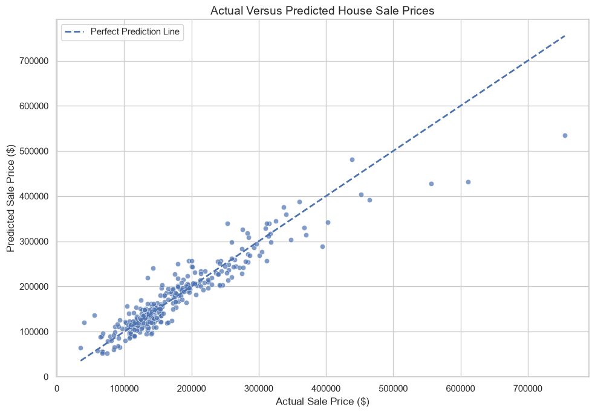
</p>

<h1 align="center">amesml</h1>

<p align="center">
  <a href="https://github.com/Ahsan-muhd-444/house-price-prediction/actions/workflows/ci.yml"></a>
  <a href="https://ahsan-muhd-444.github.io/house-price-prediction/"></a>
  <a href="https://github.com/Ahsan-muhd-444/house-price-prediction/releases/latest"></a>
  
  <a href="https://github.com/Ahsan-muhd-444/house-price-prediction/blob/main/LICENSE"></a>
  <a href="https://codecov.io/gh/Ahsan-muhd-444/house-price-prediction"></a>
  <a href="https://github.com/Ahsan-muhd-444/house-price-prediction/actions/workflows/codeql.yml"></a>
  <a href="https://github.com/pre-commit/pre-commit"></a>
  <a href="https://github.com/astral-sh/ruff"></a>
</p>

**amesml** predicts the sale price of houses in Ames, Iowa - and whether a
house sells above the median price - from 79 property features. It began as a
university machine-learning notebook and is now an installable Python package
with a command-line tool, a REST API and a Docker image. The default models
reproduce the notebook's published results closely - within about 5% - and
every saved model records how it was trained, on which data, with which
library versions.

## Why amesml

- **Reproducible.** Defaults reproduce the original analysis to within about 5%, all
  models are seeded, and each saved model carries its configuration, metrics,
  a fingerprint of its training data and a checksum of itself.
- **Installable.** One `pip install` from GitHub: a typed library and an `amesml`
  command, tested on Linux, macOS and Windows for Python 3.9-3.13 with 99%
  coverage.
- **Serveable.** A FastAPI service with validated, partial-record requests and
  an OpenAPI page, shipped as a Docker image that starts with trained models.

## Install

```bash
pip install "amesml @ git+https://github.com/Ahsan-muhd-444/house-price-prediction@v0.1.1"         # library and CLI
pip install "amesml[api] @ git+https://github.com/Ahsan-muhd-444/house-price-prediction@v0.1.1"    # plus the REST API
```

Wheels and source distributions are also attached to every
[GitHub release](https://github.com/Ahsan-muhd-444/house-price-prediction/releases).

## 60-second quickstart

**Python**

```python
from amesml import TrainConfig, load_ames, train

result = train(load_ames(), TrainConfig(model="gbm"))
print(result.metrics)
result.save("models/regression-gbm")
```

**Command line**

```bash
amesml data download
amesml train --model gbm
amesml predict --model models/regression-gbm --input data/train.csv
```

**Docker**

```bash
docker compose up --build         # API on http://localhost:8000/docs
```

## Results

Held-out test split from the notebook (292 houses, seed 42):

| Model | MAE | RMSE | R² |
| --- | ---: | ---: | ---: |
| Linear regression (notebook, reproduced within ~5%) | ~$21,140 | ~$31,791 | 0.868 |
| Gradient boosting | ~$16,826 | ~$29,462 | 0.887 |

| Model | Accuracy | Precision | Recall | F1 |
| --- | ---: | ---: | ---: | ---: |
| Logistic regression (notebook, reproduced exactly) | 94.5% | 92.5% | 95.4% | 93.9% |
| Gradient boosting | 95.2% | 92.0% | 97.7% | 94.8% |

The linear-regression figures come from an iterative solver on an
ill-conditioned matrix, so they reproduce to the cent only on Windows with
Python 3.11-3.13 and to within about 5% elsewhere; the classification
figures reproduce exactly everywhere. See
[docs/DECISIONS.md](docs/DECISIONS.md).

The classification threshold is the median sale price of the training rows,
$165,000. Cross-validated scores for every model, and an analysis of where the
models err, are in the
[benchmarks](https://ahsan-muhd-444.github.io/house-price-prediction/benchmarks/)
and the [model card](https://ahsan-muhd-444.github.io/house-price-prediction/model_card/).

## Visualizations

From the original analysis. Regenerate the package's versions with
`amesml plots`.

### Target variable

The sale price is strongly right-skewed (skewness ≈ 1.88); a log transform
brings it much closer to normal.

| Distribution | Box plot | Log transform |
| --- | --- | --- |
| 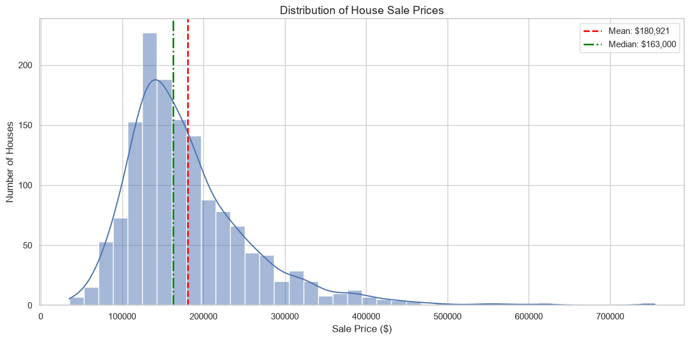 | 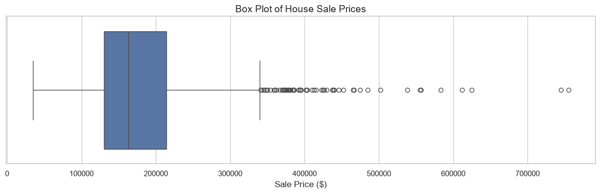 | 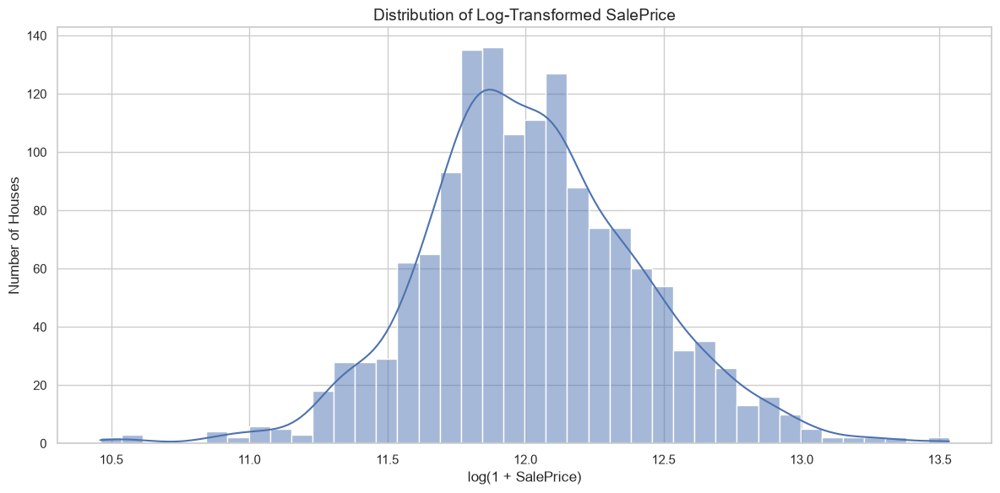 |

### Missing values

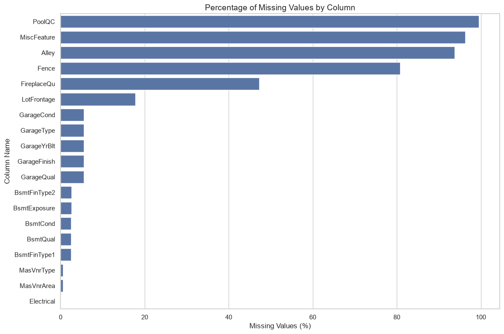

### Exploratory analysis

| Numerical distributions | Box plots | Zero-value features |
| --- | --- | --- |
| 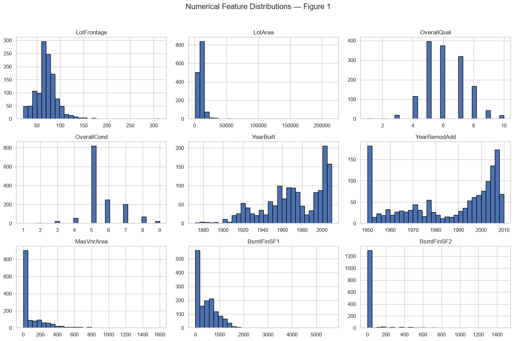 | 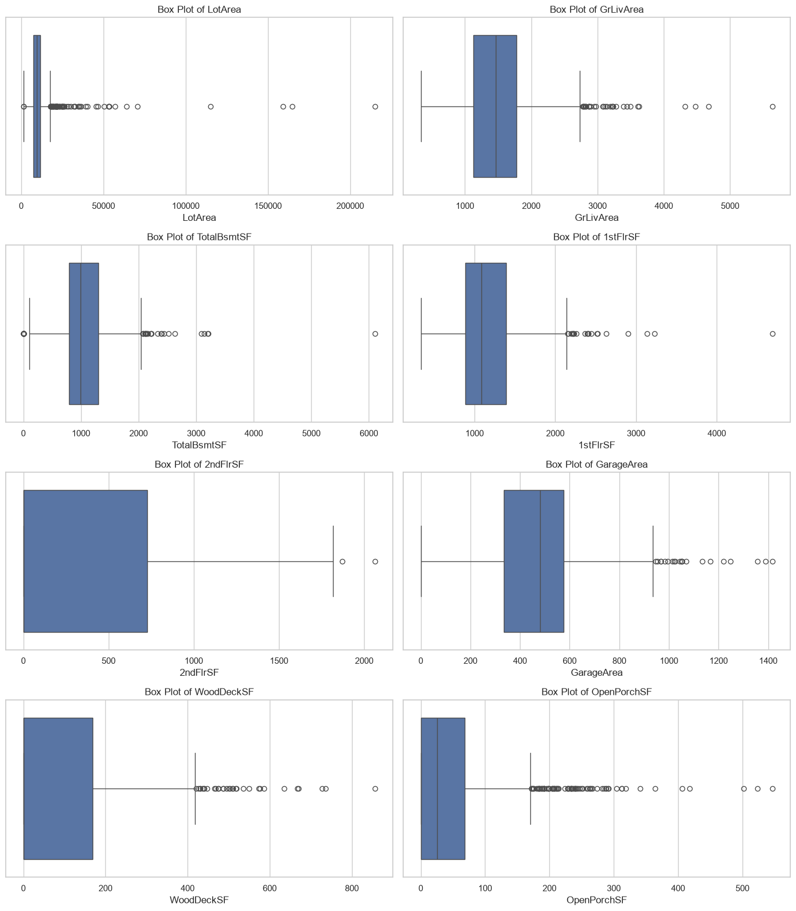 | 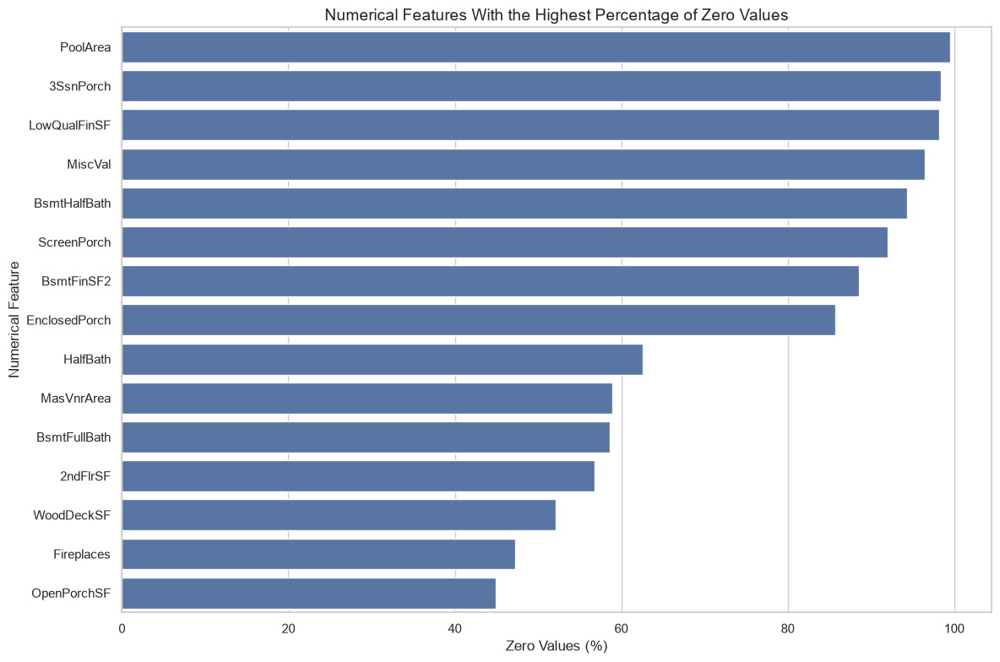 |

### Model evaluation

| Residuals vs. predicted | Residual distribution | Confusion matrix |
| --- | --- | --- |
| 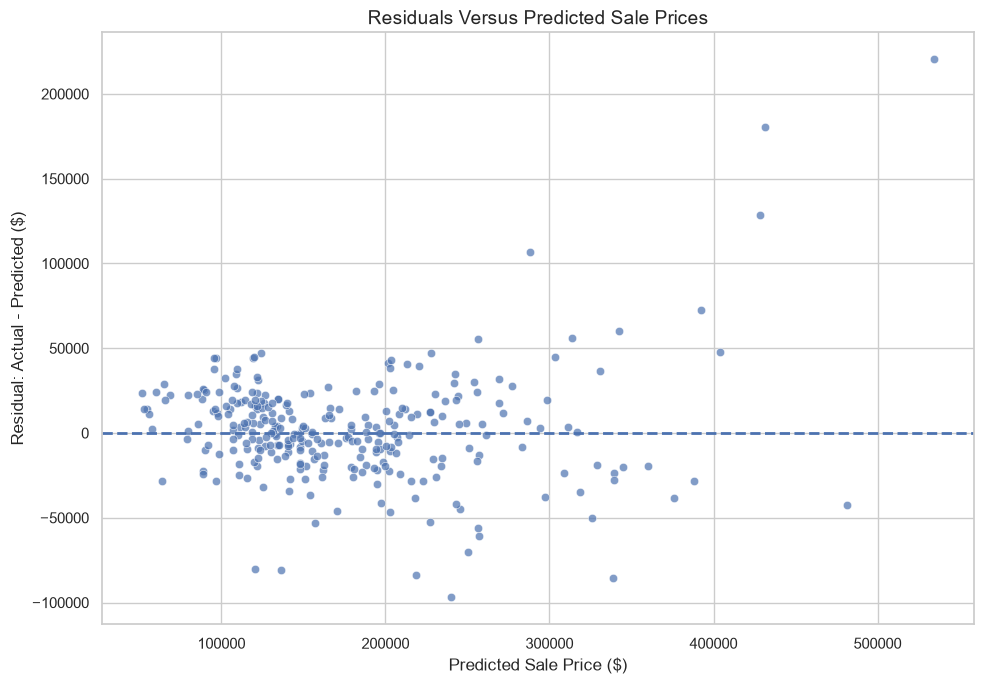 | 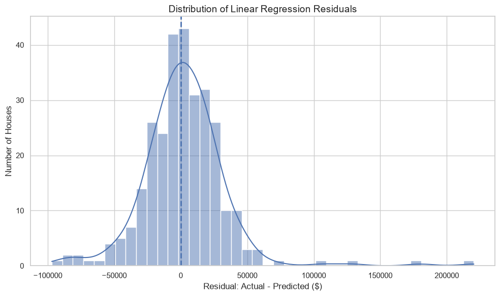 | 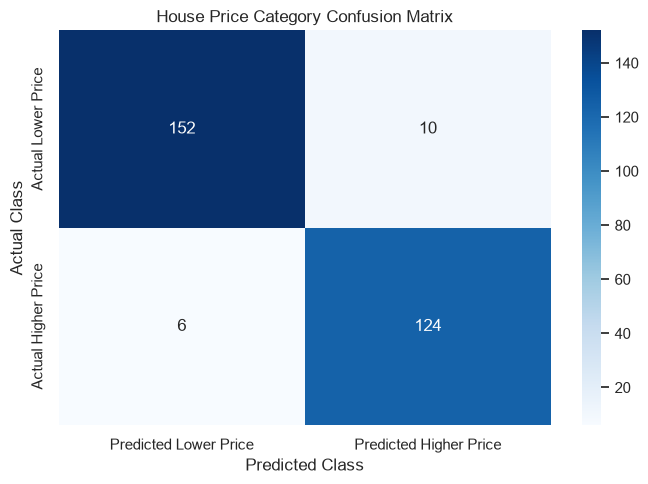 |

## Project structure

```text
house-price-prediction/
├── src/amesml/           the package
│   ├── config.py         TrainConfig, from YAML or JSON
│   ├── data.py           loading, validation, checksummed download, splitting
│   ├── features.py       engineered features
│   ├── preprocess.py     imputation, encoding and scaling
│   ├── models.py         training, saving, loading, prediction
│   ├── evaluate.py       metrics
│   ├── plots.py          figures
│   ├── cli.py            the amesml command
│   └── api.py            the FastAPI service
├── tests/                pytest suite (synthetic data, plus parity tests on the real data)
├── docs/                 MkDocs site, model card, design decisions, project report (PDF)
├── data/                 Kaggle train.csv and its data dictionary
├── notebooks/            the original notebook (outputs stripped; original in archive/)
├── images/               figures from the analysis
├── examples/             training and serving script, config and request examples
├── scripts/benchmark.py  regenerates docs/benchmarks.md
├── models/notebook/      the notebook's original pickled models
├── Dockerfile, docker-compose.yml
└── pyproject.toml, Makefile, .pre-commit-config.yaml
```

## Configuration

Every training option can live in a YAML or JSON file:

```yaml
task: classification      # or regression
model: gbm                # linear | ridge | lasso | gbm
threshold: median         # or a price, e.g. 200000
engineer_features: true   # total area, ages, bathrooms, porch area
test_size: 0.2
random_state: 42
```

```bash
amesml train --config config.yaml
```

All options are described in the
[configuration guide](https://ahsan-muhd-444.github.io/house-price-prediction/user-guide/configuration/).

## REST API

```bash
amesml serve --model models/regression-gbm
```

```bash
curl -X POST http://127.0.0.1:8000/predict \
  -H "Content-Type: application/json" \
  -d '{"records": [{"OverallQual": 7, "GrLivArea": 1710, "YearBuilt": 2003, "Neighborhood": "CollgCr", "PoolQC": null}]}'
```

```json
{"predictions": [180571.47], "model": {"task": "regression", "model": "gbm"}, "warnings": []}
```

Fields you leave out take typical training values; `null` means the feature is
absent (`"PoolQC": null` is a house without a pool). Unknown field names are
rejected. See the
[REST API guide](https://ahsan-muhd-444.github.io/house-price-prediction/user-guide/rest-api/).

## Roadmap

1. XGBoost/LightGBM model option behind an optional extra
2. `amesml explain` with SHAP
3. Hyperparameter search with `amesml tune` (Optuna)
4. Cross-validation report with confidence intervals
5. Dataset adapters for the Kaggle `test.csv` and the full De Cock data
6. Streamlit demo app (`amesml demo`)
7. Model registry: list and compare saved models
8. Tutorial notebook: "From notebook to package"
9. Publish the Docker image to GHCR on release
10. Drift check comparing incoming batches with the training data

Details: [ROADMAP](https://github.com/Ahsan-muhd-444/house-price-prediction/blob/main/.github/ROADMAP.md).

## Contributing

Contributions are welcome - see
[CONTRIBUTING.md](https://github.com/Ahsan-muhd-444/house-price-prediction/blob/main/CONTRIBUTING.md)
for the development setup, checks and commit conventions, and the
[Code of Conduct](https://github.com/Ahsan-muhd-444/house-price-prediction/blob/main/CODE_OF_CONDUCT.md).
The reasoning behind the design is in
[docs/DECISIONS.md](https://github.com/Ahsan-muhd-444/house-price-prediction/blob/main/docs/DECISIONS.md),
and the full project report is
[docs/House_Price_Prediction_MUHAMMAD_AHSAN.pdf](https://github.com/Ahsan-muhd-444/house-price-prediction/blob/main/docs/House_Price_Prediction_MUHAMMAD_AHSAN.pdf).

## Citation

```bibtex
@software{ahsan_amesml_2026,
  author  = {Ahsan, Muhammad},
  title   = {amesml: Reproducible Ames Housing price prediction},
  year    = {2026},
  version = {0.1.1},
  url     = {https://github.com/Ahsan-muhd-444/house-price-prediction}
}

@article{decock_ames_2011,
  author  = {De Cock, Dean},
  title   = {Ames, Iowa: Alternative to the Boston Housing Data as an End of
             Semester Regression Project},
  journal = {Journal of Statistics Education},
  volume  = {19},
  number  = {3},
  year    = {2011},
  doi     = {10.1080/10691898.2011.11889627}
}
```

## License

Released under the [MIT License](https://github.com/Ahsan-muhd-444/house-price-prediction/blob/main/LICENSE).

## Author

**Muhammad Ahsan** - Software Engineering, COMSATS University Lahore -
[@Ahsan-muhd-444](https://github.com/Ahsan-muhd-444)
