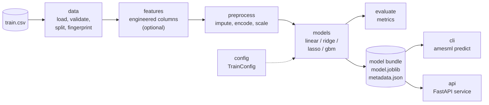
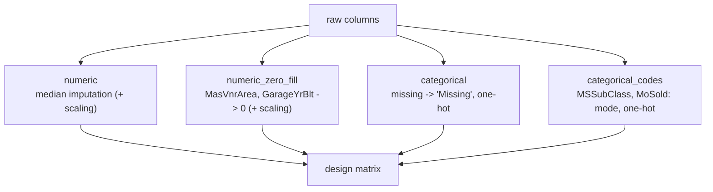

# Architecture

## Pipeline



The `features`, `preprocess` and estimator steps form a single scikit-learn
`Pipeline`, so a saved model applies exactly the same transformations to new
data as it learned in training. Everything statistical (medians, category
levels, scaling, the classification threshold) is fitted on the training rows
only.

## Modules

| Module | Responsibility |
|---|---|
| `config` | `TrainConfig`: every training option, validated, loadable from YAML or JSON |
| `data` | Ames schema, CSV conventions, validation, checksummed download, splitting, fingerprints |
| `features` | Pure functions deriving total area, ages, bathrooms and porch area |
| `preprocess` | Column typing and the `ColumnTransformer` (imputation, one-hot encoding, scaling) |
| `models` | Estimators, training, the model bundle on disk, input alignment and prediction |
| `evaluate` | Regression and classification metrics as typed dataclasses |
| `plots` | Figures, drawn with matplotlib's object-oriented API |
| `cli` | The `amesml` command (Typer) |
| `api` | The REST service (FastAPI) |
| `errors` | The exception hierarchy |

Dependencies point one way: `cli` and `api` use `models`, which uses
`preprocess`, `features`, `data` and `evaluate`. Only `cli` writes to the
terminal; library code logs through `logging.getLogger("amesml")`.

## The preprocessing transformer



Scaling is applied only where it matters (the penalised and logistic models).
The matrix is sparse for the linear models - scikit-learn's default, and the
reason the defaults reproduce the notebook's figures - and dense for gradient
boosting, which requires it.

## A saved model

```text
models/regression-gbm/
├── model.joblib     fitted pipeline, with task_, input_features_, feature_defaults_, ...
├── metadata.json    config, metrics, features, defaults, data fingerprint,
│                    library versions, SHA-256 of model.joblib
└── metrics.json     held-out metrics
```

`load_model` refuses a `model.joblib` whose checksum no longer matches its
metadata. The API reads `metadata.json` for `/model/info`.

## Serving

`create_app()` loads every model once at startup, keyed by task, and fails to
start if any is missing or invalid, so a misconfigured container crashes
immediately instead of failing on its first request. Requests are validated by
Pydantic, aligned to the model's columns by `records_to_frame`, and scored by
the same `predict` function the CLI uses.

## Quality gates

Every push runs ruff, the ruff formatter, strict mypy, the test suite with
coverage on Linux, macOS and Windows for Python 3.9, 3.11, 3.12 and 3.13, a
distribution build with `twine check`, a Docker build with an HTTP smoke test,
a strict documentation build, and CodeQL.
